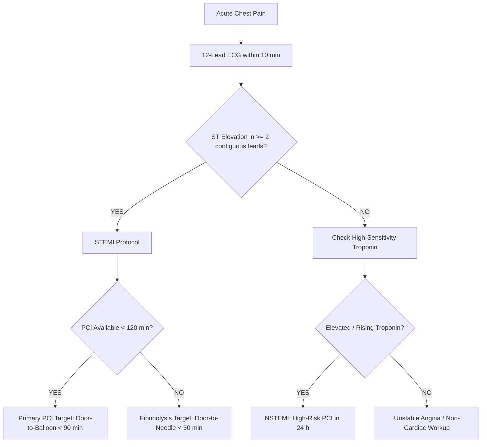

## 1. ECG Rhythm & Lead II Morphology

Hook: acute myocardial ischemia is a race against time ("time is muscle"); the 12-lead ECG is the definitive bedside triage gate that decides between emergency cardiac catheterization and medical stabilization.

:::definition The Normal PQRST Cardiac Cycle

- **P wave**: Atrial depolarization (normal duration $< 120\,\text{ms}$, amplitude $< 2.5\,\text{mm}$).
- **PR interval**: AV nodal delay ($120–200\,\text{ms}$ / 3–5 small squares; prolonged in 1st degree AV block).
- **QRS complex**: Ventricular depolarization ($< 120\,\text{ms}$; widened in bundle branch blocks or VT).
- **ST segment**: Isoelectric baseline between depolarization and repolarization ($\ge 1\,\text{mm}$ elevation $\Rightarrow$ transmural injury).
- **T wave**: Ventricular repolarization (hyperacute peaked in hyperkalemia or early ischemia; inverted in subacute MI).
  :::

```ecg
# Baseline: Normal Sinus Rhythm (72 bpm, flat ST segment, normal axis)
rate=72 rhythm=sinus st=flat axis=+60
```

```ecg
# Acute Transmural Infarction: Sinus Tachycardia with Marked ST Elevation (STEMI)
rate=88 rhythm=sinus st=elevated axis=+60
```

```ecg
# Ischemic Arrhythmia: Atrial Fibrillation with Rapid Ventricular Rate & ST Depression
rate=145 rhythm=afib st=depressed axis=+30
```

:::formula Emergency ACS Antiplatelet & Anticoagulant Loading Doses (Adult)

- **Aspirin**: $300\,\text{mg}$ orally (chewed for rapid buccal absorption, non-enteric coated).
- **Ticagrelor**: $180\,\text{mg}$ loading dose (or Clopidogrel $600\,\text{mg}$ if Ticagrelor contraindicated).
- **Unfractionated Heparin (UFH)**: $60\,\text{units/kg}$ IV bolus (max $4\,000\,\text{units}$), then $12\,\text{units/kg/h}$.
- **Sublingual Nitroglycerin**: $0.4\,\text{mg}$ spray/tablet every 5 min (up to 3 doses), unless contraindicated!
  :::

:::trap The Right Ventricular Infarction (Inferior STEMI) Trap
**NEVER administer nitrates or morphine to patients with Right Ventricular (RV) Infarction!**
Right ventricular infarction occurs in ~40% of inferior STEMIs (RCA occlusion in leads II, III, aVF). The failing RV is extremely preload-dependent; venodilators (nitroglycerin) cause catastrophic drop in preload $\Rightarrow$ refractory cardiogenic shock.
_Management: IV crystalloid fluid bolus, NOT nitrates._
:::

## 2. Coronary Artery Territories & ECG Lead Mapping

In myocardial infarction, specific ECG leads look directly at specific anatomical myocardial walls supplied by culprit arteries:

| Myocardial Territory | 12-Lead ECG Leads                             | Culprit Coronary Artery   | Clinical Risk & Complications                                             |
| -------------------- | --------------------------------------------- | ------------------------- | ------------------------------------------------------------------------- |
| **Inferior**         | II, III, aVF                                  | **RCA** (85%) / LCx (15%) | RV infarction, bradycardia, AV block (RCA feeds AV node).                 |
| **Anterior**         | V3, V4                                        | **LAD** ("Widowmaker")    | Massive LV dysfunction, cardiogenic shock, heart failure.                 |
| **Septal**           | V1, V2                                        | Proximal **LAD**          | Bundle branch block, ventricular septal rupture.                          |
| **Lateral**          | I, aVL, V5, V6                                | **LCx** or Diagonal LAD   | High lateral ischemia (often missed if looking only at precordial leads). |
| **Posterior**        | V1–V3 (reciprocal ST depression, tall R wave) | **RCA** / LCx             | True posterior STEMI; confirm by placing leads V7–V9 on the back!         |

```figure
https://images.unsplash.com/photo-1576091160550-2173dba999ef?auto=format&fit=crop&w=800&q=80 | Clinical Cardiac Monitoring and 12-Lead Lead Placement (Click to zoom)
```

## 3. Cardiac Biomarkers & Kinetics

When a patient develops recurrent chest pain 4 days after an initial MI, Troponin cannot diagnose re-infarction because it stays elevated for up to 2 weeks. **CK-MB** is the gold standard for detecting re-infarction:

| Biomarker                                   | Initial Detectable Rise | Peak Concentration | Normalization Window | Core Exam Rule                                                            |
| ------------------------------------------- | ----------------------- | ------------------ | -------------------- | ------------------------------------------------------------------------- |
| **High-Sensitivity Troponin (hs-cTnI / T)** | 2–3 hours               | 12–24 hours        | **10–14 days**       | Most sensitive & specific for acute myocardial necrosis.                  |
| **CK-MB (Creatine Kinase-MB)**              | 4–6 hours               | 18–24 hours        | **48–72 hours**      | **Best test for detecting re-infarction** (re-rises after 3 days).        |
| **Myoglobin**                               | 1–2 hours               | 6–8 hours          | 24 hours             | Earliest marker to rise; low specificity (also rises in skeletal trauma). |

## 4. Emergency Triage Pathway



## 5. Differential Diagnosis: Chest Pain Mimics

| Clinical Condition     | ECG Findings                                               | Chest Pain Quality                                           | Differentiating Sign                                                     |
| ---------------------- | ---------------------------------------------------------- | ------------------------------------------------------------ | ------------------------------------------------------------------------ |
| **STEMI**              | Regional convex ST elevation, reciprocal ST depression     | Crushing substernal, radiates to jaw/left arm                | Elevated cardiac troponin I/T; regional wall motion abnormality on echo. |
| **Acute Pericarditis** | Diffuse, concave-up ST elevation; PR depression in lead II | Sharp, pleuritic, worse lying flat, relieved sitting forward | Pericardial friction rub; normal or minimally elevated troponin.         |
| **Aortic Dissection**  | Usually normal; or inferior STEMI if flap tears RCA        | Tearing, ripping pain radiating to interscapular back        | Unequal bilateral pulse/BP (>20 mmHg diff); wide mediastinum on CXR.     |
| **Pulmonary Embolism** | Sinus tachycardia; S1Q3T3 pattern; RV strain               | Acute dyspnea, pleuritic pain, tachypnea                     | Elevated D-dimer, positive CT Pulmonary Angiography (CTPA).              |

:::mnemonic MONA Triage Protocol

- **M**orphine: IV for refractory pain/anxiety (use judiciously; delays oral P2Y12 absorption).
- **O**xygen: Only if $SpO_2 < 90\%$ (hyperoxia causes paradoxical coronary vasoconstriction).
- **N**itrates: Sublingual or IV for angina (verify SBP > 90 mmHg and no RV infarct or PDE-5 inhibitor use).
- **A**spirin: $150–300\,\text{mg}$ chewed immediately for irreversible COX-1 inhibition.
  :::

## 6. Worked Clinical Exam Cases

:::exercise tag:exam
A 62-year-old diabetic male presents to the Emergency Department with 90 minutes of acute crushing chest pressure and diaphoresis. Blood pressure is $135/85\,\text{mmHg}$, heart rate is $76\,\text{bpm}$.
The 12-lead ECG demonstrates $2.5\,\text{mm}$ ST-elevation in leads II, III, and aVF, with reciprocal ST-depression in leads I and aVL.

What is the anatomical territory, the culprit vessel, and the immediate reperfusion target?
:::solution

1. **Anatomical diagnosis**: **Inferior STEMI** (ST elevations in inferior leads II, III, aVF).
2. **Culprit artery**: **Right Coronary Artery (RCA)** in 85–90% of cases (dominant right circulation), or LCx in 10–15%.
3. **Immediate management**:
   - Obtain right-sided ECG leads (V3R, V4R) to rule out concurrent Right Ventricular infarction.
   - Dual Antiplatelet Therapy (DAPT): Aspirin $300\,\text{mg}$ chewed + Ticagrelor $180\,\text{mg}$ loading dose + Heparin.
   - Reperfusion: Immediate transfer for **Primary Percutaneous Coronary Intervention (PCI)** with a **door-to-balloon time < 90 minutes**.
     _Where students lose marks: recommending fibrinolysis when cardiac catheterization is available within 120 minutes._
     :::
     :::

:::exercise tag:medium
A 24-year-old medical student presents with sharp retrosternal chest pain that worsens when taking a deep breath and when lying supine, but improves significantly upon sitting forward. ECG reveals widespread concave ST elevation across leads I, II, aVF, V2–V6 with PR segment depression.

What is the most likely diagnosis and first-line treatment?
:::solution

1. **Diagnosis**: **Acute Pericarditis**.
2. **Clinical reasoning**: Pleuritic and positional chest pain (relieved by sitting upright), diffuse concave-upward ST elevations, and pathognomonic PR segment depression distinguish pericarditis from ischemic STEMI.
3. **First-line pharmacotherapy**: High-dose NSAIDs (e.g. Ibuprofen $600\,\text{mg}$ TID) plus **Colchicine** ($0.5\,\text{mg}$ daily) for 3 months to prevent recurrences.
   :::
   :::

## 7. Exam Traps & Clinical Checklist

:::checklist Clinical Red Flags List

- [ ] Oxygen is indicated ONLY if $SpO_2 < 90\%$ (routine oxygen in normoxic patients increases myocardial infarct size).
- [ ] Diabetics, elderly, and women often present with **atypical ACS** (silent ischemia: nausea, dyspnea, fatigue without classic chest pain).
- [ ] New LBBB (Left Bundle Branch Block) in the setting of ischemic symptoms is treated as a **STEMI equivalent** (Sgarbossa criteria).
- [ ] Always ask about PDE-5 inhibitor use (Sildenafil, Tadalafil) before giving nitrates (fatal refractory hypotension).
- [ ] Peak troponin indicates infarct size, but initial normal troponin (< 3 h from onset) does NOT rule out unstable angina or early STEMI.
      :::

```quiz
1. Which coronary artery is most commonly occluded in an inferior myocardial infarction (leads II, III, aVF)?
   a) Left Anterior Descending (LAD)   b) Right Coronary Artery (RCA)   c) Left Circumflex (LCx)
   ! b
   > RCA supplies the inferior wall in 85-90% of individuals (right-dominant anatomy).
2. Which medication is strictly contraindicated in a patient with inferior STEMI and suspected right ventricular extension?
   a) Aspirin   b) Sublingual Nitroglycerin   c) Unfractionated Heparin
   ! b
   > Nitrates reduce preload; the infarcted right ventricle requires high preload to maintain cardiac output.
3. What is the target door-to-balloon time for primary PCI in STEMI?
   ! < 90 minutes (under 90 minutes)
   > ACC/AHA and ESC guidelines mandate door-to-balloon time under 90 minutes for PCI-capable hospitals.
```

```flashcards
STEMI vs Pericarditis ECG :: STEMI = localized convex ST elevation + reciprocal depression; Pericarditis = diffuse concave ST elevation + PR depression
Inferior STEMI Leads :: II, III, aVF (RCA culprit)
Anterior STEMI Leads :: V1–V4 (LAD culprit — highest mortality)
Aspirin ACS Loading Dose :: 300 mg chewed (non-enteric coated) for immediate antiplatelet effect
```
