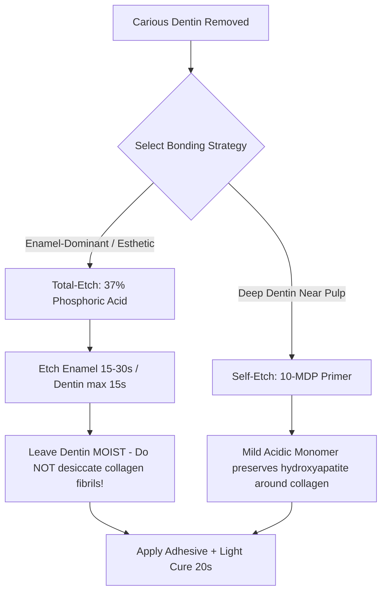

## 1. The FDI Dental Odontogram & Surface Mapping

Hook: tooth identification in clinical practice must be universal, unambiguous, and instant; the **FDI Two-Digit Numbering System** divides the human dentition into four quadrants and numbers teeth from the midline backward.

:::definition FDI Two-Digit Notation & Tooth Surfaces

- **Quadrants**: 1 = Maxillary Right, 2 = Maxillary Left, 3 = Mandibular Left, 4 = Mandibular Right.
- **Teeth per quadrant**: 1 (Central Incisor) through 8 (Third Molar). E.g. **Tooth 16** = Maxillary Right First Permanent Molar.
- **Surfaces**:
  - **M** (Mesial): Surface facing toward the dental midline.
  - **D** (Distal): Surface facing away from the midline.
  - **O** (Occlusal) / **I** (Incisal): Biting / masticatory surface.
  - **B** (Buccal) / **V** (Vestibular): Surface facing the cheek or lips.
  - **L** (Lingual) / **P** (Palatal): Surface facing the tongue or palate.
    :::

```odontogram
# Adult Restorative Dental Chart (FDI System)
tooth=16 surface=MOD status=caries
tooth=14 surface=DO status=amalgam
tooth=21 surface=M status=composite
tooth=26 surface=all status=crown
tooth=36 surface=all status=crown
tooth=46 status=missing
tooth=47 surface=O status=caries
```

:::formula Dental Local Anesthesia Maximum Recommended Dose (MRD)
For **Lidocaine 2% with 1:100,000 Epinephrine** ($36\,\text{mg}$ lidocaine per $1.8\,\text{mL}$ cartridge):
$$\text{Max Dose} = 4.4\,\text{mg/kg} \qquad (\text{Absolute Maximum: } 300\,\text{mg} \approx 8.3 \text{ cartridges})$$
_For a $70\,\text{kg}$ adult: $70 \times 4.4 = 308\,\text{mg} \Rightarrow \text{capped at } 300\,\text{mg} \div 36\,\text{mg/cartridge} = 8.3 \text{ cartridges}._
:::

:::trap The Irreversible Pulpitis Cold Test Trap
A tooth with **irreversible pulpitis** typically exhibits severe lingering pain (> 10–15 seconds) to cold stimulus (Endo-Ice).
However, a **completely necrotic pulp** produces **no response to cold** (false-negative vitality). Never assume a painless, non-responsive tooth is healthy—always verify periapical radiolucency and percussion sensitivity!
:::

## 2. G.V. Black's Classification of Cavities

| Class         | Anatomical Location                                                               | Typical Teeth                          | Preferred Restorative Material      |
| ------------- | --------------------------------------------------------------------------------- | -------------------------------------- | ----------------------------------- |
| **Class I**   | Pit and fissure cavities (Occlusal of molars/premolars; lingual pits of incisors) | Molars, premolars, upper incisors      | Composite resin or amalgam          |
| **Class II**  | Proximal surfaces of posterior teeth (involving interproximal contact)            | Premolars & molars (e.g. MO, DO, MOD)  | Sectional matrix + composite resin  |
| **Class III** | Proximal surfaces of anterior teeth **NOT** involving the incisal angle           | Incisors & canines (e.g. Mesial of 21) | Microhybrid or nanofill composite   |
| **Class IV**  | Proximal surfaces of anterior teeth **INVOLVING** the incisal corner/angle        | Incisors & canines                     | Multi-shade layered composite       |
| **Class V**   | Gingival third of facial or lingual surfaces of any tooth                         | Any tooth (cervical caries/abfraction) | Resin-modified glass ionomer (RMGI) |
| **Class VI**  | Cusp tips of posterior teeth or incisal edges of anterior teeth (abrasion/wear)   | Canines, incisors, molar cusps         | Direct composite or onlay           |

## 3. Adhesive Dentistry: Etch-and-Rinse vs Self-Etch



:::formula The C-Factor (Cavity Configuration)
$$\text{C-Factor} = \frac{\text{Number of Bonded Surfaces}}{\text{Number of Unbonded Surfaces}}$$
_In a Class I occlusal cavity: 5 bonded walls (B, L, M, D, pulpal floor) vs 1 unbonded surface (occlusal opening) $\Rightarrow \text{C-Factor} = 5/1 = 5$._
**High C-factor ($\ge 3$) causes severe polymerization shrinkage stress $\Rightarrow$ incremental layering ($\le 2\,\text{mm}$) is mandatory!**
:::

## 4. Worked Operative Dentistry Exam Cases

:::exercise tag:exam
A 28-year-old female presents for a routine dental examination. Clinical inspection reveals an active cavitated carious lesion on the disto-occlusal surface of tooth 25 (maxillary left second premolar). The pulp is responsive and asymptomatic.

1. What is the G.V. Black classification?
2. What matrix system is indicated for restoring the distal contact?
3. Calculate the maximum number of 2% lidocaine (1:100,000 epi) cartridges for this patient weighing $55\,\text{kg}$.
   :::solution
4. **Classification**: **Class II cavity** (involves the proximal distal surface and occlusal surface of a posterior tooth).
5. **Matrix System**: **Sectional matrix system with a separating ring and anatomical wedge**. Tofflemire circumferential bands produce flat interproximal contours with open contacts, whereas sectional rings achieve tight, anatomically curved proximal contact points.
6. **Anesthetic Calculation**:
   - Patient weight: $55\,\text{kg}$.
   - Max dose: $55\,\text{kg} \times 4.4\,\text{mg/kg} = 242\,\text{mg}$ lidocaine.
   - Cartridge content: $1.8\,\text{mL} \times 20\,\text{mg/mL} = 36\,\text{mg}$ per cartridge.
   - Max cartridges: $\frac{242\,\text{mg}}{36\,\text{mg/cartridge}} = 6.7$ cartridges (round down to $6.5$ cartridges).
     :::
     :::

:::exercise tag:medium
Why is desiccating (over-drying) etched dentin with prolonged air blasts detrimental to composite bond strength?
:::solution

1. **Mechanism**: Acid etching with $37\%$ phosphoric acid dissolves mineral hydroxyapatite, leaving a delicate scaffold of demineralized collagen fibrils.
2. **Consequence of over-drying**: Excessive air desiccation causes the unsupported collagen mesh to collapse onto itself like dry spaghetti, occluding the dentinal tubules.
3. **Adhesive failure**: The hydrophobic adhesive monomers cannot penetrate the collapsed collagen network, leading to poor hybrid layer formation, microleakage, and severe post-operative sensitivity.
   :::
   :::

## 5. Exam Traps & Operative Checklist

:::checklist Operative Dental Checklist

- [ ] Rubber dam isolation is the single most effective predictor of resin bond longevity.
- [ ] Never etch dentin for more than 15 seconds (causes deep demineralization that adhesive cannot penetrate).
- [ ] In Class II restorations, always place the wedge from the larger embrasure (typically lingual).
- [ ] Check occlusion in maximum intercuspation (MIP) AND lateral excursion with $40\,\mu\text{m}$ articulating paper.
- [ ] Verify interproximal contact with dental floss (floss should snap cleanly through contact without shredding).
      :::

```quiz
1. In the FDI two-digit system, what tooth number represents the permanent mandibular right first molar?
   a) 36   b) 46   c) 16
   ! b
   > Quadrant 4 is mandibular right; tooth 6 is the first molar (46).
2. Which G.V. Black classification describes caries on the incisal edge of tooth 11 without proximal involvement?
   a) Class IV   b) Class V   c) Class VI
   ! c
   > Class VI involves incisal edges of anterior teeth or cusp tips of posterior teeth.
3. What is the C-Factor of a standard Class I occlusal cavity?
   ! 5 (or 5/1)
   > 5 bonded surfaces (4 walls + floor) divided by 1 unbonded surface = 5.
```

```flashcards
FDI Quadrants :: 1 = Max Right, 2 = Max Left, 3 = Mand Left, 4 = Mand Right
Class II Cavity :: Proximal surface of posterior teeth (premolars/molars)
Class IV Cavity :: Proximal surface of anterior teeth involving the incisal edge
Dentin Desiccation Trap :: Over-drying collapses collagen fibrils, preventing adhesive resin infiltration
Lidocaine 2% MRD :: 4.4 mg/kg up to 300 mg maximum
```
