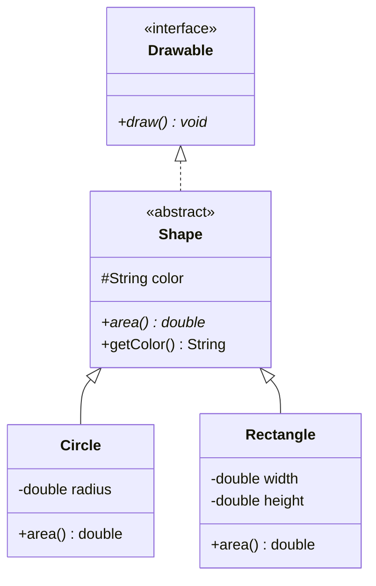

## 1. Inheritance & Dynamic Method Dispatch

Hook: inheritance models an _is-a_ relationship, but polymorphism is the actual
engine: code operates on references to abstractions while the JVM dispatches
to concrete subclass logic at runtime.

:::definition Dynamic Method Dispatch (vtable)
The JVM resolves non-static, non-private, non-final method calls using the **actual runtime object type**, not the declared reference type, by inspecting the object's virtual method table (`vtable`).
:::



```java
// Base abstraction with contract comments
abstract class Shape implements Drawable {
    protected String color;
    public Shape(String color) { this.color = color; }
    public abstract double area(); // Contract: non-negative area in square units
}

class Circle extends Shape {
    private final double radius;
    public Circle(String color, double radius) {
        super(color);
        this.radius = radius;
    }
    @Override
    public double area() { return Math.PI * radius * radius; }
    @Override
    public void draw() { System.out.println("Drawing " + color + " circle"); }
}
```

```terminal
user@linux:~$ javac Shape.java Circle.java Main.java
user@linux:~$ java Main
# Drawing red circle
# Area: 78.5398
user@linux:~$ javap -c Main.class
# invokespecial: constructor <init>
# invokevirtual: area() resolved dynamically via vtable
```



```dot
digraph VTableDispatch {
    rankdir=LR;
    node [shape=box, style="rounded,filled", fillcolor="#f8fafc", color="#94a3b8", fontname="sans-serif", fontsize=10];
    edge [fontname="sans-serif", fontsize=9, color="#64748b"];

    Ref [label="Reference ref\n(Declared: Shape)", fillcolor="#e0f2fe", color="#38bdf8"];
    Heap [label="Heap Object Instance\n(Header + Fields)", fillcolor="#dcfce7", color="#22c55e"];
    Klass [label="Circle.class\nClass Metadata", fillcolor="#fef3c7", color="#f59e0b"];
    VTable [label="vtable[slot]\n&Circle::area()", fillcolor="#fee2e2", color="#ef4444"];
    Code [label="Subclass Machine Code\nMath.PI * r * r", fillcolor="#f3e8ff", color="#a855f7"];

    Ref -> Heap [label="points to"];
    Heap -> Klass [label="class pointer"];
    Klass -> VTable [label="vtable lookup"];
    VTable -> Code [label="direct jump"];
}
```

:::trap The Field Shadowing Reflex
Instance methods are resolved **dynamically** at runtime by object type.
Instance variables (fields) and static methods are resolved **statically at compile time** by reference type. If a subclass redeclares field `x`, `((Parent) child).x` reads the parent field!
:::

## 2. Abstract Classes vs Interfaces

A class can extend only **one** class (single inheritance), but can implement **multiple** interfaces.

| Feature               | Abstract Class                           | Interface (`Java 8+`)                    | Choose When…                                                          |
| --------------------- | ---------------------------------------- | ---------------------------------------- | --------------------------------------------------------------------- |
| **Inheritance model** | Single (`extends`)                       | Multiple (`implements`)                  | Use interfaces for capabilities; abstract class for core identity.    |
| **State / Fields**    | Can hold instance fields & constructors  | `public static final` constants only     | You need mutable instance state across subclasses.                    |
| **Methods**           | Abstract, concrete, private, protected   | Abstract, `default`, `static`, `private` | You are defining a behavior contract (`Comparable`, `AutoCloseable`). |
| **Access Modifiers**  | `public`, `protected`, `package-private` | Implicitly `public` (unless `private`)   | Internal base class needs protected helper methods.                   |

:::mnemonic SOLID

- **S**ingle Responsibility: one reason to change.
- **O**pen/Closed: open for extension, closed for modification.
- **L**iskov Substitution: subtypes must behave like supertypes without breaking invariants.
- **I**nterface Segregation: prefer multiple small interfaces over one fat interface.
- **D**ependency Inversion: depend on abstractions, never on concretions.
  :::

## 3. Reference Casting & Type Safety

```plot3d
# 3D Vector Space: Subclass Polymorphic Projection
vector: 2, 2, 2.5 label="Subclass Vector (Circle)" color="#22c55e"
vector: 2, 2, 0 label="Projected Interface (Drawable)" color="#38bdf8"
vector: 0, 0, 2.5 label="Specialized State Dimension" color="#f59e0b"
```

:::formula Safe Downcasting Rule

```java
// Always guard downcasts with pattern matching (Java 16+)
if (shape instanceof Circle c) {
    System.out.println("Radius is: " + c.getRadius());
}
```

_Never cast blindly: `(Circle) shape` throws `ClassCastException` if `shape` is a `Rectangle`._
:::

:::trap The equals / hashCode Contract
If you override `equals(Object o)`, you **MUST** override `hashCode()`.
If `a.equals(b)` is `true`, then `a.hashCode() == b.hashCode()` must be strictly true. Violating this breaks all hash-based collections (`HashMap`, `HashSet`), causing "invisible" dropped objects.
:::

## 4. Worked Exam Exercises

:::exercise tag:exam
What is the exact terminal output of the following Java program?

```java
class A {
    int val = 10;
    void print() { System.out.println("A:" + val); }
}
class B extends A {
    int val = 20;
    void print() { System.out.println("B:" + val); }
}
public class Test {
    public static void main(String[] args) {
        A ref = new B();
        System.out.println(ref.val);
        ref.print();
    }
}
```

:::solution

1. **Approach**: Decompose static type binding (fields) vs dynamic virtual binding (methods).
2. Reference `ref` has declared type `A`, but runtime object type `B`.
3. `ref.val` accesses field `val`: fields are **not polymorphic**. The compiler binds to `A.val` $\Rightarrow$ prints `10`.
4. `ref.print()` calls method `print()`: methods are **virtual**. The JVM executes `B.print()` $\Rightarrow$ prints `B:20`.
5. **Output**:

```text
10
B:20
```

_Where students lose marks: assuming `ref.val` prints 20 because `new B()` was instantiated._
:::
:::

:::exercise tag:medium
Suppose interface `Alpha` and interface `Beta` both define default method `default void greet() { ... }`. What happens if class `Service implements Alpha, Beta`?
:::solution

1. **Approach**: Diamond inheritance conflict rule in Java 8+.
2. The code **fails to compile** with: `class Service inherits unrelated defaults for greet() from types Alpha and Beta`.
3. **Resolution**: `Service` must explicitly override `greet()` and resolve the ambiguity, e.g.:

```java
@Override
public void greet() {
    Alpha.super.greet(); // or custom logic
}
```

:::
:::

## 5. Exam Traps & Checklist

:::checklist Night-Before OOP List

- [ ] Constructors are **never** inherited; subclasses must call `super(...)`.
- [ ] `final` class cannot be extended; `final` method cannot be overridden.
- [ ] Private methods cannot be overridden (they are not visible in the vtable).
- [ ] Overriding cannot reduce visibility (`public` method cannot become `protected`).
- [ ] Checked exceptions: overriding method cannot throw broader checked exceptions than superclass.
      :::

```quiz
1. Which keyword prevents an instance method from being overridden in a subclass?
   a) static   b) final   c) abstract
   ! b
   > final prevents method overriding; static hides methods without polymorphism.
2. Given Animal a = new Cat(), what determines which version of an overridden method executes?
   a) The reference type Animal   b) The runtime object type Cat   c) The compiler classpath
   ! b
   > Dynamic dispatch uses the actual object instance on the heap at runtime.
3. If two objects evaluate to true using equals(), what MUST be true about their hashCode()?
   ! They must be equal (same hash code)
   > The Object contract requires equal objects to yield identical hashCodes.
```

```flashcards
Dynamic Dispatch :: Method execution resolved at runtime by actual object type
Shadowing :: Subclass field hiding superclass field (bound at compile time)
Liskov Substitution :: Subclasses must fulfill superclass contracts without breaking clients
Abstract vs Interface :: Abstract class holds mutable state/constructors; interface defines behavioral contracts
```
