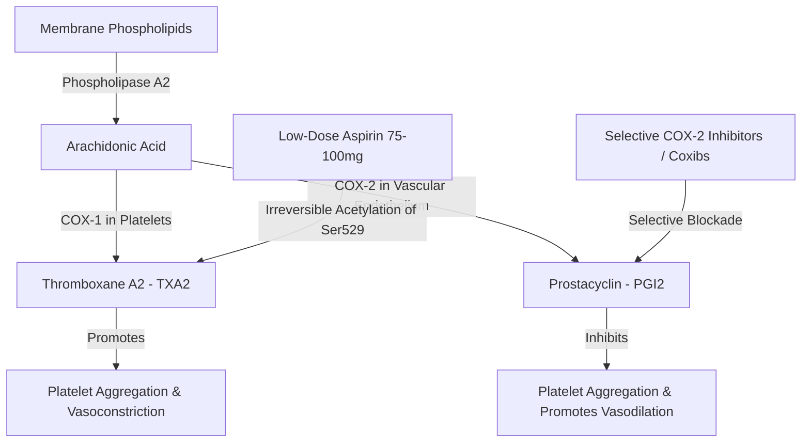

## 1. 2D Molecular Chemical Structures of Analgesics

Hook: Non-Steroidal Anti-Inflammatory Drugs (NSAIDs) represent the most widely consumed class of medications worldwide; their therapeutic anti-inflammatory, analgesic, and antipyretic actions—as well as their gastrointestinal and cardiovascular toxicities—stem from competitive or irreversible inhibition of cyclooxygenase enzymes.

:::definition Cyclooxygenase Isozymes (COX-1 vs COX-2)

- **COX-1 (Constitutive)**: Expressed in gastric mucosa, platelets, and renal parenchyma. Synthesizes protective $PGE_2$ (gastric cytoprotection) and $TXA_2$ (platelet aggregation).
- **COX-2 (Inducible)**: Rapidly upregulated at sites of inflammation, endothelial shear stress, and neoplasia by cytokines (IL-1, TNF-$\alpha$). Synthesizes pro-inflammatory prostaglandins and endothelial $PGI_2$ (prostacyclin: vasodilator, inhibits platelet aggregation).
  :::

```smiles
# 2D Skeletal Molecular Structures of Key Analgesic Compounds
CC(=O)Oc1ccccc1C(=O)O // Aspirin (Acetylsalicylic Acid - Irreversible COX-1/2 Inhibitor)
CC(C)Cc1ccc(cc1)C(C)C(=O)O // Ibuprofen (Propionic Acid NSAID - Non-Selective)
CC(=O)Nc1ccc(O)cc1 // Acetaminophen (Paracetamol - Central Analgesic)
Cc1ccc(cc1)c2cc(nn2c3ccc(cc3)S(=O)(=O)N)C(F)(F)F // Celecoxib (Selective COX-2 Inhibitor)
```

:::formula Henderson–Hasselbalch Equation & Gastric Ion Trapping
For weak acidic NSAIDs (e.g. Aspirin $\text{p}K_a \approx 3.5$, Ibuprofen $\text{p}K_a \approx 4.4$):
$$\text{pH} = \text{p}K_a + \log\left(\frac{[\text{A}^-]}{[\text{HA}]}\right) \implies \frac{[\text{HA}]}{[\text{Total}]} = \frac{1}{1 + 10^{\text{pH} - \text{p}K_a}}$$
_In the acidic stomach ($\text{pH} \approx 1.5$): Aspirin is predominantly non-ionized ($\approx 99\% \text{ HA}$), allowing rapid passive diffusion across gastric epithelial cell membranes. Inside neutral cytoplasm ($\text{pH} \approx 7.2$), it ionizes to $\text{A}^-$, becoming trapped ("ion trapping") and disrupting mitochondrial oxidative phosphorylation._
:::

```plot
# Henderson-Hasselbalch Non-Ionized Fraction [HA] vs pH for Weak Acid (pKa = 3.5)
# pH from 1 (stomach) to 7 (intestine/blood)
y = 1 / (1 + 10^(x - 3.5)) from 1 to 7
```

:::trap The Aspirin + Ibuprofen Timing Trap
**Taking Ibuprofen before low-dose Aspirin abolishes Aspirin's cardioprotective antiplatelet effect!**
Ibuprofen binds reversibly near Ser529 in the COX-1 hydrophobic catalytic channel, physically blocking Aspirin from accessing and irreversibly acetylating Ser529. Once Ibuprofen dissociates, platelet COX-1 recovers $TXA_2$ synthesis!
_Guideline Rule: Take low-dose immediate-release Aspirin at least 2 hours BEFORE Ibuprofen, or take Ibuprofen at least 8 hours after Aspirin._
:::

## 2. Arachidonic Acid Cascade & Platelet Balance



| Drug | Selectivity Ratio (COX-2 / COX-1) | Primary Clinical Indication | Major Toxicity / Risk |\n|---|---|---|---|\n| **Aspirin** | $0.01$ (Strongly COX-1 selective) | Cardioprotection ($75–100\,\text{mg}$), analgesia | Gastric ulcers, GI bleeding, Reye syndrome in children |\n| **Ibuprofen** | $\approx 1$ (Balanced non-selective) | Mild-to-moderate pain, fever | GI irritation, reversible renal impairment |\n| **Indomethacin** | $\approx 0.5$ (COX-1 > COX-2) | Acute gouty arthritis, closure of patent ductus arteriosus | Severe frontal headaches, GI hemorrhage |\n| **Celecoxib** | $\approx 30$ (COX-2 selective) | Osteoarthritis, rheumatoid arthritis | Thrombotic cardiovascular events (MI, stroke), fluid retention |\n\n## 3. Worked Medicinal Chemistry Exam Cases

:::exercise tag:exam
Explain why platelets cannot recover cyclooxygenase activity after exposure to Aspirin, whereas vascular endothelial cells recover within hours.
:::solution

1. **Enzyme Inactivation**: Aspirin transfers an acetyl group covalently to Ser529 in COX-1, irreversibly inactivating the enzyme.
2. **Anucleate Platelets**: Platelets have no nucleus or ribosomes and **cannot synthesize new proteins**. The COX-1 blockade persists for the entire lifespan of the platelet ($8–10\text{ days}$).
3. **Endothelial Cells**: Vascular endothelial cells contain active nuclei and de novo protein synthesis machinery, regenerating fresh unacetylated COX-2 within $2–4\text{ hours}$.
   _This differential recovery is the pharmacokinetic foundation of low-dose ($75–100\,\text{mg}$) daily Aspirin prophylaxis._
   :::
   :::

:::exercise tag:medium
Why do selective COX-2 inhibitors (e.g. Rofecoxib, Celecoxib) increase the relative risk of myocardial infarction compared to non-selective NSAIDs?
:::solution

1. **Unbalanced Hemostasis**: Selective COX-2 inhibitors suppress endothelial **$PGI_2$ (prostacyclin)**, which normally inhibits platelet activation and induces vasodilation.
2. **Spared Platelet COX-1**: They do **not** inhibit platelet COX-1, leaving platelet **$TXA_2$ (thromboxane)** production completely intact.
3. **Pro-thrombotic State**: The resulting imbalance ($TXA_2 \gg PGI_2$) promotes unopposed platelet aggregation, vasoconstriction, and acute coronary thrombosis.
   :::
   :::

## 4. Exam Traps & Pharmacy Checklist

:::checklist Clinical Pharmacology Checklist

- [ ] Low-dose aspirin irreversibly acetylates COX-1 Ser529 for the lifetime of the platelet (8–10 days).
- [ ] Triple Whammy Risk: Combining an **ACE inhibitor + Diuretic + NSAID** causes acute prerenal renal failure.
- [ ] Acetaminophen (Paracetamol) has analgesic and antipyretic properties but **lacks peripheral anti-inflammatory action**.
- [ ] Never administer Aspirin to children or adolescents with viral syndromes (varicella/influenza) due to fatal **Reye syndrome**.
- [ ] Co-prescribe a Proton Pump Inhibitor (PPI, e.g. Omeprazole) in patients $> 65$ years requiring chronic NSAID therapy.
      :::

```quiz
1. Which chemical group on Aspirin is covalently transferred to the serine residue of cyclooxygenase?
   a) Carboxyl group   b) Acetyl group   c) Phenyl group
   ! b
   > Acetylsalicylic acid acetylates Ser529 in COX-1 and Ser516 in COX-2.
2. Why is Acetaminophen NOT classified as a traditional NSAID?
   a) It does not bind COX-1/2   b) It lacks significant peripheral anti-inflammatory activity   c) It is a strong base
   ! b
   > In inflamed peripheral tissues, high peroxide concentrations inhibit acetaminophen's COX reduction.
3. What is the target amino acid acetylated by aspirin in human COX-1?
   ! Ser529 (Serine 529)
   > Irreversible covalent acetylation of Ser529 blocks arachidonate binding.
```

```flashcards
Aspirin Mechanism :: Irreversible covalent acetylation of COX-1 Ser529 and COX-2 Ser516
COX-1 Products :: Gastric protective PGE2 and platelet pro-thrombotic TXA2
COX-2 Products :: Inducible inflammatory prostaglandins and endothelial anti-thrombotic PGI2
Triple Whammy Interaction :: ACE inhibitor + Diuretic + NSAID causing acute renal failure
Aspirin-Ibuprofen Timing :: Take Aspirin >= 2h before Ibuprofen to prevent competitive inhibition
```
