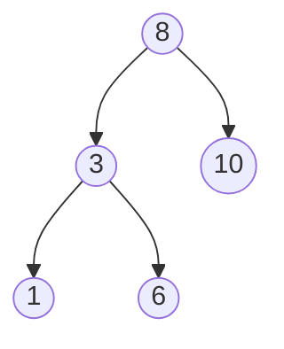

# Domain Pack — Computer Science

Applies when `subject:` is CS, ALSDD (algorithms & data structures), Linux /
shell, networking, or low-level topics (8086 assembly). No new syntax —
existing embeds only.

## The diagram mandate (hard rule)

**A section that teaches a data structure, state machine, or protocol MUST
include a `mermaid` or `dot` diagram.** _(Evidence: the older trees guide
taught BSTs, traversals, and rotations with zero tree drawings — code and
prose only. That is the failure mode this rule exists to kill.)_

| Concept                                     | Render it as                                                                                      |
| ------------------------------------------- | ------------------------------------------------------------------------------------------------- |
| Trees (BST, AVL rotations, heaps)           | `mermaid` `graph TD` — draw the tree _before_ and _after_ mutation when rotation/insert is taught |
| Linked structures, pointer rewiring         | `mermaid` `graph LR` with edge labels (`next`, `prev`)                                            |
| Automata, parsers, protocols                | `dot` (precise layout)                                                                            |
| Algorithm flow                              | `mermaid` `graph TD` with diamond decision nodes                                                  |
| Recursion                                   | call-stack **table** for a concrete small input (n = 3): depth, call, return                      |
| Memory layout / 8086 segments, stack frames | `mermaid` `graph BT` or a table of address → content                                              |
| Register state during execution             | **table**: step → instruction → AX/BX/flags after                                                 |
| Complexity intuition                        | `plot`: `log(x)`, `x`, `x*log(x)`, `x^2`, `2^x` overlaid                                          |
| ML Loss Landscapes & Optimization           | `plot3d`: `z = x^2 - y^2 from -2 to 2` (saddle point / gradient descent)                          |

## Pedagogy conventions

1. **ADT anatomy is fixed**: invariant (what's always true) → operations
   table → C implementation → edge cases → traps.
2. **Operations table always carries complexity**, asymptotic _and_ concrete:
   `O(log n)` **and** "n=10³ → ~10 steps". Big-O alone is exam poison.
3. **Code discipline**: fenced with `c` (or `nasm`, `bash`, `pseudo`);
   every function gets a 1-line contract comment; the code must be
   conceptually compilable — no `...` elisions inside logic.
4. **Recursion rule**: show the base case first, the recursive case second,
   then the concrete trace table — never define recursion by example alone.
5. **Assembly rule**: instruction tables include columns _purpose, operands,
   flags affected_ (the older guides' flag tables were right — keep them),
   and every program ≤ 12 lines gets a register-trace table.
6. **Linux rule**: every `:::exercise` is a task → exact commands →
   "common wrong variants" table (e.g., primary vs secondary group,
   `-r` vs `-rf`, relative vs absolute path). Use `terminal` blocks for the
   reference solution.
7. **Comparisons are tables** (array vs linked list, REF vs RREF-analog:
   pre/in/post-order, TCP vs UDP), each row ending in a "choose X when…" cell.

## Content traps worth a `:::trap`

- Off-by-one in loop bounds and array indices.
- Empty tree / single-node / two-node cases in structure code.
- `malloc` without `free`, dangling pointers, returning stack addresses.
- Missing recursive base case → stack overflow.
- `chmod 755` vs `750` — numeric rwx mapping errors.
- `useradd -g` (primary) vs `-G` (secondary) confusion.
- `INT` vs `DIV` operand sizes and the DX:AX pairing in 8086.

## Section skeleton

````markdown
## <Structure or algorithm>

:::definition <Invariant>
<What is always true about the structure.>
:::


````

```c
<Node/insert code with contract comments>
```

| Operation | Complexity | n = 1 000 |
| --------- | ---------- | --------- |
| insert    | O(log n)   | ~10       |

:::trap <Edge case or classic bug>
:::

:::exercise tag:exam
<Task or trace question.>
:::solution
<Trace table or code + reasoning.>
:::
:::

```

```
